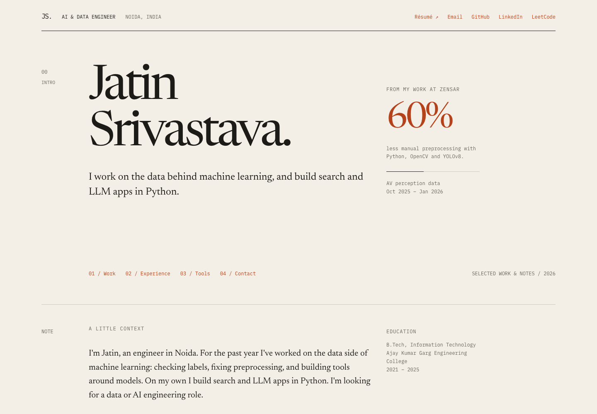
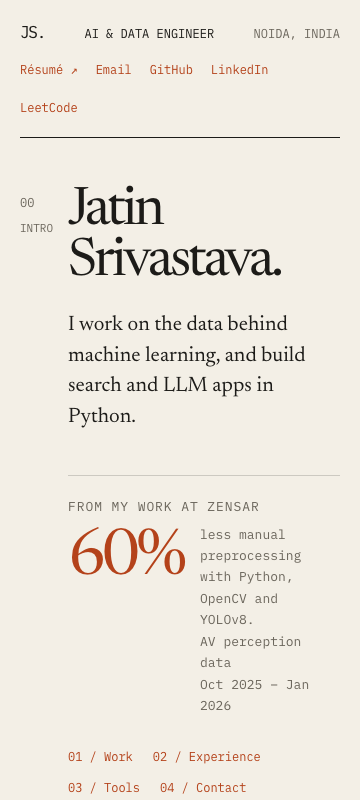

# Validation

Checked locally on 20 October 2026, using Chrome and Lighthouse 12.8.2.

| Page | Performance | Accessibility | Best practices | SEO |
| --- | ---: | ---: | ---: | ---: |
| Home | 99 | 100 | 100 | 100 |
| NeuroLabel AI | 99 | 100 | 100 | 100 |
| RAG-IT | 100 | 100 | 100 | 100 |
| Prayaas | 100 | 100 | 100 | 100 |

Lighthouse used its default mobile emulation against the local HTTP preview. These are lab measurements, not production field data. The local Python preview does not provide the caching and compression supplied by the deployment host.

- All nine HTML pages returned HTTP 200 and loaded local fonts and images at 360, 768 and 1440 pixels in both light and dark modes (54 page/viewport/theme combinations).
- No document-level horizontal overflow or browser JavaScript errors.
- Axe-core 4.10.3 found zero WCAG A/AA violations across nine pages in both themes at 360 pixels (18 scans).
- Followed the home Work anchor and NeuroLabel case-study link; verified the keyboard skip link is the first focus target.
- Checked 115 local link/asset references, old home section anchors, and every original navigation destination recorded in `preserved-links.json`.
- Normal text contrast on light paper: ink 15.01:1, muted 4.97:1, accent 4.90:1. On dark paper: ink 14.79:1, muted 6.46:1, accent 6.79:1.
- Visually inspected desktop, 360-pixel mobile, a dark case study, technical diagrams and all five pages of the printed home page. Fixed the mobile figure spacing and the header accessible-name mismatch during review.
- `npm run check`, `npm run build` and `git diff --check` pass.
- The external `.demo` destinations remain unverified placeholders, clearly labeled as such. Preservation of external URLs is checked; availability of all third-party destinations is not guaranteed.

## Preview captures

